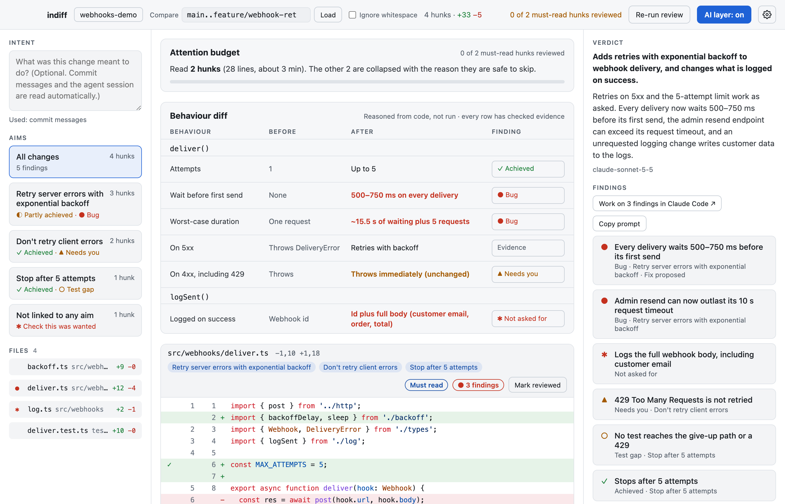
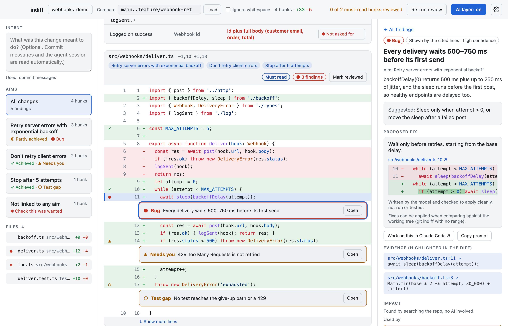
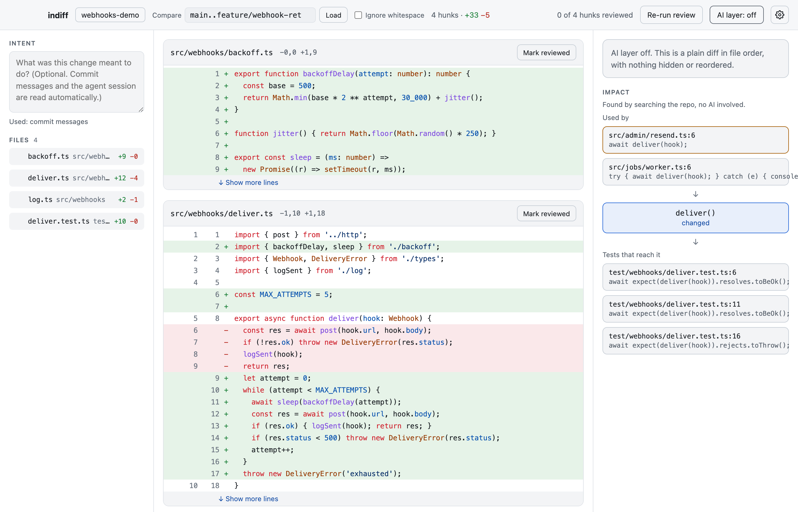
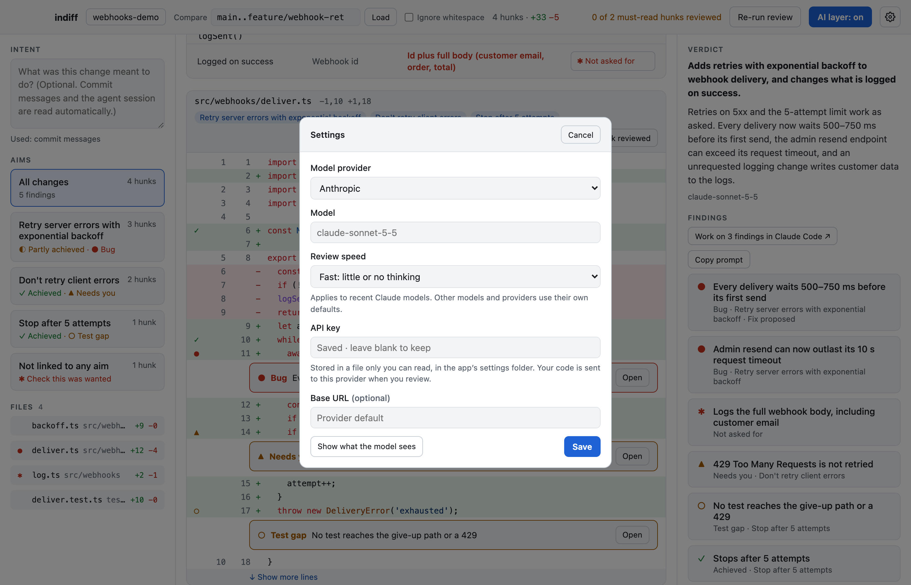

# indiff

**A diff that reviews the change.** Open a git range and indiff shows the normal diff with a review layered on top: what the change does, what you must read, what it was meant to do, and what's wrong with it.



macOS only. You bring your own API key (Anthropic, or any OpenAI-compatible endpoint). Want a look first? [Try the demo](#try-the-demo) with no app and no key.

## Quick start

1. [Build and install the app](#build-it-on-your-mac).
2. Click the gear icon, paste your API key and save.
3. In any git repository, run `git indiff` (after adding the [git alias](#use-it)).
4. Read the **Attention budget**, work through the findings with `n` / `p`, and mark hunks reviewed.

## What you get

- **Behaviour diff**: what each changed function did before and does now: attempts, errors, timing, side effects.
- **Attention budget**: which hunks you must read, and why the rest are safe to skip.
- **Aims**: what the change was meant to do, taken from your note, your Claude Code session and commit messages, and whether each aim was met. Changes that serve no aim are flagged.
- **Findings**: bugs, security problems, decisions only you can make, test gaps and scope creep. Each finding shows its evidence, and you can jump to the exact lines.
- **Proposed fixes**: for bugs and security findings, a small edit you can read as a diff and apply with one click when reviewing the working tree. Each edit's text must match the code exactly once, or the fix is removed.
- **Hand off to Claude Code**: send one finding, or all open bugs, security findings and test gaps, to Claude Code. iTerm2 (or Terminal, if iTerm2 isn't installed) opens in the repository with Claude already working from the findings, their evidence and the diff command.
- **Impact**: where the changed code is used and which tests reach it. This comes from searching the repo; no AI is involved.
- **AI layer off**: one click gives you a plain diff in file order, with nothing hidden.
- **A diff that's easy to read**: syntax highlighting, with the changed words marked inside each changed line. You can show more lines around any hunk and jump to any file from the file list. **Ignore whitespace** hides reformatting.
- **Keeps up with your edits**: when the files change (in your editor, or by Claude Code after a handoff), the diff updates within a few seconds. The review isn't re-run on its own, because that costs money. Instead, hunks the review hasn't seen are marked **Changed since review**, and one click re-runs it.

### Findings, with evidence and fixes

Click a finding to see why it was raised, the exact lines it cites (highlighted in the diff), and where the code is used. For bugs and security problems, indiff shows a proposed fix as a small diff.



### Prefer a plain diff?

**AI layer** turns the review off and shows an ordinary diff in file order, with nothing hidden.



Every claim the model makes must cite real lines. indiff checks each citation against the files and **removes claims whose quoted code doesn't exist**, then tells you what it removed.

## Build it on your Mac

You need Xcode's command line tools and Rust.

```sh
xcode-select --install                                   # skip if already installed
curl --proto '=https' --tlsv1.2 -sSf https://sh.rustup.rs | sh
cargo install tauri-cli --version "^2" --locked          # one-off, a few minutes

cd indiff/app
cargo tauri build --bundles app
cp -R ../target/release/bundle/macos/indiff.app /Applications/
```

To try it without building a bundle, run `cargo run --release -p indiff` from inside a git repository.

## Use it

Add a git alias once, so `git indiff` opens the app in the background:

```sh
git config --global alias.indiff '!f() { /Applications/indiff.app/Contents/MacOS/indiff "$@" >/dev/null 2>&1 & }; f'
```

Then, in any repository:

| Command | Reviews |
|---|---|
| `git indiff` | Uncommitted changes against HEAD |
| `git indiff --staged` | Staged changes |
| `git indiff main..HEAD` | Commits on your branch |
| `git indiff main...feature` | A branch since it split from main |

You can also open the app from Applications and choose a repository, or type a range in the **Compare** box.



**API key:** click the gear icon and paste an Anthropic key. The default model is `claude-sonnet-5-5`, which you can change there. OpenAI-compatible endpoints (OpenAI, OpenRouter, Ollama) also work. **Review speed** is Fast by default: on recent Claude models, thinking is turned off where the model allows it and effort is set to low. Choose Thorough to let the model think first. The verdict shows how long the review took and how many tokens it wrote. When launched with `git indiff`, the app can also use `ANTHROPIC_API_KEY` from your shell.

**Intent:** indiff automatically reads:
- your commit messages
- the newest Claude Code session for the repository from the last two days, from `~/.claude/projects` (pick another in the sidebar)
- anything you type in the Intent box

Click **Re-run review** after changing these.

**Keys:** `n` / `p` move to the next or previous finding, and `Esc` closes things.

## Good to know

- **Your code goes to the model provider** when you review. **Settings → Show what the model sees** shows exactly what's sent.
- **The review reasons about the code; it doesn't run it.** Findings are marked either "shown by the cited lines" or "inferred, not run".
- **Reviews are cached** in `.git/indiff-cache`, so reopening the same diff is instant and free. Delete that folder to clear it.
- **Fixes are checked, not tested.** indiff confirms a fix applies cleanly, then writes it; it doesn't run anything. The diff updates by itself once it's written.
- **Claude Code handoff** needs `claude` on your shell's PATH. The first time, macOS asks to let indiff control iTerm2 or Terminal. Prompts are saved in `.git/indiff-handoff`. **Copy prompt** works anywhere.
- **Reviewed hunks** are remembered for each repository by their content, so a hunk stays reviewed while other files change, and resets if it changes.
- **Syntax highlighting** covers about 35 common languages, using [highlight.js](https://highlightjs.org) (BSD-3-Clause, in `ui/vendor`). Very large or minified files are shown plain.
- **Your API key** is stored in `~/Library/Application Support/dev.indiff.app/settings.json`, readable only by you.

## Current limits

- **One model call per review:** the model gets the diff, the full changed files and the places that use changed symbols. It can't explore further, and very large changes are truncated (it says so).
- **Rough symbol search:** finding callers uses pattern matching, not a language server, so it can miss some uses or include false ones.
- **Claude Code only:** it's the only agent whose sessions are detected automatically.
- **Unified view only:** there's no side-by-side view yet.
- **No inline comments or GitHub PR integration yet.**

## Try the demo

Open `ui/index.html` in a browser to explore a real review of a sample change, with no app and no key.

## Project layout

```
engine/   Rust library: git, diff parsing, context, model call, citation checks
app/      Tauri desktop app (thin wrapper over the engine)
ui/       The interface: plain HTML/CSS/JS, no build step
examples/webhook/   A sample repo and a saved model reply, used for tests and the demo
```

- **Demo:** see [Try the demo](#try-the-demo).
- **Sample repo:** recreate it with `examples/webhook/setup.sh /tmp/webhook-demo`.
- **Engine data:** `cargo run -p indiff-engine --example dump -- <repo> <range> [saved-reply]` prints what the app receives.
